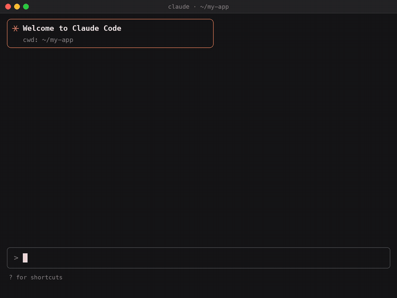

<h1 align="center">ShotLingo MCP: App Store screenshot generator for Claude, Cursor and VS Code</h1>

<p align="center">
  Describe the screenshots you want. Your agent writes the copy in 41 languages, ShotLingo renders the pixels,<br>
  the set is <b>uploaded straight to App Store Connect or Google Play</b>, and it can <b>start an App Store product page A/B test</b> with it.
</p>

<p align="center">
  <a href="https://registry.modelcontextprotocol.io"></a>
  <a href="#claude-code"></a>
  <a href="#cursor"></a>
  <a href="LICENSE"></a>
  <a href="https://github.com/AlperenGuntekin/shotlingo-mcp/stargazers"></a>
</p>

<p align="center">
  
</p>

## Try it free: audit any App Store page

No account, no key. One GET, sourced from Apple's public data:

```bash
curl -s "https://mcp.shotlingo.com/audit?app=https://apps.apple.com/us/app/id6748750121&format=md"
```

Real output for one of our own apps (excerpt, read 2026-10-29):

```
# Store page audit: Breaker: Conversation Starters (US)
- [medium] 5 of 10 iPhone screenshot slots used. 5 slots are unused. The top 5 free apps
  in Entertainment (US) use a median of 6 iPhone screenshots.
- [info] 0 of 10 major storefronts show the same screenshot files as US.
  Every storefront checked has its own screenshot files.
- [info] 0 iPad screenshots. 4 of 5 top apps in your category have iPad screenshots.
- [info] 2 ratings in US, average 5.0. Median of the top 5 in your category: 99314 ratings.
```

It checks 10 major storefronts for untranslated screenshots and descriptions, flags languages
your app speaks but its store page does not show, and compares you with the top free apps in
your category. What the public data cannot show (caption text, App Previews) is listed as not measured.

## Install the skills in one command

```bash
npx skills add AlperenGuntekin/shotlingo-mcp
```

Installs three skills into Claude Code, Cursor, Codex and the other agents the `skills` CLI supports:
`store-audit` (the free audit above), `app-store-screenshots` (screenshot design rules) and
`shotlingo` (how to drive the MCP tools). The skills are free and need no account.

## Install the MCP server in one line

The hosted MCP server renders and uploads; it needs a paid ShotLingo plan (see [Pricing](#pricing-and-the-free-path)).

<a id="claude-code"></a>
**Claude Code** (plugin: MCP server + screenshot design skill + ShotLingo tool guide skill + `/shotlingo:localize` command)

```bash
claude plugin install shotlingo --marketplace AlperenGuntekin/shotlingo-mcp
```

Inside a Claude Code session, or on a Claude Code version older than 2.1.292:

```
/plugin marketplace add AlperenGuntekin/shotlingo-mcp
/plugin install shotlingo@shotlingo
```

Then run `/mcp`, pick `plugin:shotlingo:shotlingo` and sign in.

Only the server, no plugin:

```bash
claude mcp add --transport http shotlingo https://mcp.shotlingo.com/mcp
```

**Claude (web and desktop):** Settings, Connectors, Add custom connector, paste `https://mcp.shotlingo.com/mcp`.

<a id="cursor"></a>
**Cursor:** [Add to Cursor](cursor://anysphere.cursor-deeplink/mcp/install?name=shotlingo&config=eyJ1cmwiOiJodHRwczovL21jcC5zaG90bGluZ28uY29tL21jcCJ9), or put this in `~/.cursor/mcp.json`:

```json
{ "mcpServers": { "shotlingo": { "url": "https://mcp.shotlingo.com/mcp" } } }
```

**VS Code:**

```bash
code --add-mcp '{"name":"shotlingo","type":"http","url":"https://mcp.shotlingo.com/mcp"}'
```

**Clients that only speak stdio:**

```json
{ "mcpServers": { "shotlingo": { "command": "npx", "args": ["-y", "mcp-remote", "https://mcp.shotlingo.com/mcp"] } } }
```

The first tool call opens a browser window to sign in to ShotLingo (OAuth 2.1 with PKCE). No API key to copy, nothing stored in this repo.

## What you can ask for

> "Make a 6.9-inch App Store set for my habit tracker from these five simulator screenshots, one benefit per screen, then translate it into German, Japanese and Brazilian Portuguese."

> "Take my English set, localize it for the top five markets, render all of it and upload it to App Store Connect."

> "Which captions overflow in German? Shorten them and re-render only those pages."

## What you get

| Step | Tools |
|---|---|
| Start from a template or your own screenshots | `list_templates`, `get_template`, `adapt_template`, `create_project`, `duplicate_project`, `import_image`, `import_store_screenshots` |
| Edit the layout | `generate_page`, `apply_device_frame`, `update_project`, `fit_text_into_design` |
| Localize | `set_translations`, `get_translations` (41 languages, right-to-left included) |
| Render | `render_screenshot`, `start_batch`, `get_batch_status` |
| Ship | `export_to_app_store`, `export_to_google_play`, `list_app_store_apps`, `list_google_play_apps` |
| Account | `get_usage`, `list_projects` |

Text is fitted by the same export pipeline the ShotLingo web editor uses, so a German caption that runs long shrinks to fit instead of spilling off the frame.

The Claude Code plugin also ships:

- **`store-audit` skill:** runs the free store page audit above and reads the result back without adding claims.
- **`app-store-screenshots` skill:** the screenshot design rules we use: what the first three screens must do, caption length, sizes, localization traps, App Review rules. It works on its own, with no account.
- **`shotlingo` skill:** how to drive the ShotLingo tools: which ones only read, which ones edit the design and which ones touch a live listing, how to undo with saved versions, render without hitting the rate limit, and set up an App Store product page test.
- **`/shotlingo:localize` command:** one command from "here is my English set" to a rendered, localized set.

## Pricing and the free path

- The skills in this repo and the store page audit are free and need no account.
- The ShotLingo web editor at [shotlingo.com](https://shotlingo.com) has a free plan.
- The MCP connector needs a paid plan (Pro, Plus or Studio). Store upload needs Plus or Studio. Limits are on [shotlingo.com/plans](https://shotlingo.com/plans).

## How it works

```
your agent ──MCP over HTTPS──▶ mcp.shotlingo.com ──▶ ShotLingo renderer ──▶ PNGs / App Store Connect / Google Play
```

The server is hosted and closed source. This repo is the open part: client configs, the Claude Code plugin and the design skill. Bugs and feature requests for the server are welcome here as issues.

## Privacy

This repo collects nothing: it is configuration and Markdown. What the hosted service stores is described in [shotlingo.com/privacy](https://shotlingo.com/privacy).

## Contributing

Better screenshot rules, client configs for more editors, and clearer docs are all welcome. Open a pull request or an issue. Run `npm test` before you push.

## License

MIT for everything in this repository. The ShotLingo service has its own [terms](https://shotlingo.com/terms).
