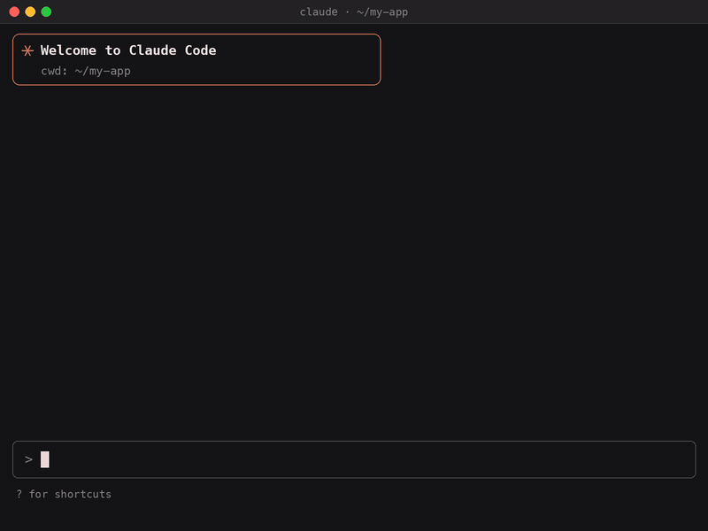

<h1 align="center">ShotLingo MCP: App Store screenshot generator for Claude, Cursor and VS Code</h1>

<p align="center">
  Tell your agent: <i>"make my App Store screenshots in 12 languages and upload them."</i><br>
  It designs the set, writes the captions in 41 languages, ShotLingo renders the pixels,<br>
  the set goes <b>straight to App Store Connect or Google Play</b>, and it can <b>start an App Store product page A/B test</b> with it.
</p>

<p align="center">
  <a href="https://registry.modelcontextprotocol.io"></a>
  <a href="#claude-code"></a>
  <a href="#cursor"></a>
  <a href="LICENSE"></a>
  <a href="https://github.com/AlperenGuntekin/shotlingo-mcp/stargazers"></a>
</p>

<p align="center">
  
</p>

## Connect in one line

Server URL: `https://mcp.shotlingo.com/mcp` (hosted, streamable HTTP, sign in with your ShotLingo account on the first tool call, no API key to copy).

```bash
claude mcp add --transport http shotlingo https://mcp.shotlingo.com/mcp
```

Then ask Claude Code something from the list below. For Claude web and desktop, Cursor, VS Code and stdio-only clients see [Install](#install).

The MCP connector needs a paid ShotLingo plan (Pro, Plus or Studio); store upload and A/B tests need Plus or Studio. Limits are on [shotlingo.com/plans](https://shotlingo.com/plans?utm_source=github-readme&utm_medium=readme&utm_campaign=mcp). The skills and the store page audit in this repo are free and need no account.

## What you can ask for

**1. Build a set from your own screens**
> "Make a 6.9-inch App Store set for my habit tracker from these five simulator screenshots, one benefit per screen."

Uses `create_project`, `import_image`, `generate_page`, `apply_device_frame`. Or start from `list_templates`, `get_template` and `adapt_template`.

**2. Localize and render everything**
> "Translate the set into German, Japanese and Brazilian Portuguese and render all of it."

Uses `set_translations` (41 languages, right-to-left included), `start_batch` and `get_batch_status`.

**3. Fix captions that do not fit**
> "Which captions overflow in German? Shorten them and re-render only those pages."

Uses `fit_text_into_design` and `render_screenshot`. Text is fitted by the same export pipeline the ShotLingo web editor uses, so a long German caption shrinks to fit instead of spilling off the frame.

**4. Upload, then test it**
> "Upload the localized set to App Store Connect, then set up a product page A/B test with it."

Uses `list_app_store_apps`, `export_to_app_store` (and `export_to_google_play` for Android), then `estimate_ab_test`, `create_ab_test`, `list_ab_tests`, `record_ab_result` and `stop_ab_test`.

**Undo is built in.** `save_version` before a risky edit, `restore_version` to go back; deleted projects come back with `restore_project`.

## Install

<a id="claude-code"></a>
**Claude Code plugin** (MCP server + screenshot design skill + ShotLingo tool guide skill + `/shotlingo:localize` command)

```bash
claude plugin install shotlingo --marketplace AlperenGuntekin/shotlingo-mcp
```

Inside a Claude Code session, or on a Claude Code version older than 2.1.292:

```
/plugin marketplace add AlperenGuntekin/shotlingo-mcp
/plugin install shotlingo@shotlingo
```

Then run `/mcp`, pick `plugin:shotlingo:shotlingo` and sign in.

**Claude (web and desktop):** Settings, Connectors, Add custom connector, paste `https://mcp.shotlingo.com/mcp`.

<a id="cursor"></a>
**Cursor:** [Add to Cursor](cursor://anysphere.cursor-deeplink/mcp/install?name=shotlingo&config=eyJ1cmwiOiJodHRwczovL21jcC5zaG90bGluZ28uY29tL21jcCJ9), or put this in `~/.cursor/mcp.json`:

```json
{ "mcpServers": { "shotlingo": { "url": "https://mcp.shotlingo.com/mcp" } } }
```

**VS Code:**

```bash
code --add-mcp '{"name":"shotlingo","type":"http","url":"https://mcp.shotlingo.com/mcp"}'
```

**Clients that only speak stdio:**

```json
{ "mcpServers": { "shotlingo": { "command": "npx", "args": ["-y", "mcp-remote", "https://mcp.shotlingo.com/mcp"] } } }
```

The first tool call opens a browser window to sign in to ShotLingo (OAuth 2.1 with PKCE). Nothing is stored in this repo.

## Tools by step

| Step | Tools |
|---|---|
| Start from a template or your own screenshots | `list_templates`, `get_template`, `adapt_template`, `create_project`, `duplicate_project`, `import_image`, `import_store_screenshots` |
| Edit the layout | `generate_page`, `add_page`, `add_text`, `add_image`, `add_shape`, `update_element`, `apply_device_frame`, `fit_text_into_design`, `update_project` |
| Localize | `set_translations`, `get_translations` |
| Render | `render_screenshot`, `start_batch`, `get_batch_status` |
| Ship | `export_to_app_store`, `export_to_google_play`, `list_app_store_apps`, `list_google_play_apps` |
| Test | `estimate_ab_test`, `create_ab_test`, `list_ab_tests`, `record_ab_result`, `stop_ab_test` |
| Undo | `save_version`, `list_versions`, `restore_version`, `list_trash`, `restore_project` |
| Account | `get_usage`, `list_projects` |

The full, current tool list is what the server returns from `tools/list`; some tools appear only for accounts that have the matching feature on.

## Try it free: audit any App Store page

No account, no key. One GET, sourced from Apple's public data:

```bash
curl -s "https://mcp.shotlingo.com/audit?app=https://apps.apple.com/us/app/id6748750121&format=md"
```

Real output for one of our own apps (excerpt, read 2026-10-29):

```
# Store page audit: Breaker: Conversation Starters (US)
- [medium] 5 of 10 iPhone screenshot slots used. 5 slots are unused. The top 5 free apps
  in Entertainment (US) use a median of 6 iPhone screenshots.
- [info] 0 of 10 major storefronts show the same screenshot files as US.
  Every storefront checked has its own screenshot files.
- [info] 0 iPad screenshots. 4 of 5 top apps in your category have iPad screenshots.
- [info] 2 ratings in US, average 5.0. Median of the top 5 in your category: 99314 ratings.
```

It checks 10 major storefronts for untranslated screenshots and descriptions, flags languages
your app speaks but its store page does not show, and compares you with the top free apps in
your category. What the public data cannot show (caption text, App Previews) is listed as not measured.

## Skills

```bash
npx skills add AlperenGuntekin/shotlingo-mcp
```

Installs three skills into Claude Code, Cursor, Codex and the other agents the `skills` CLI supports. They are free and need no account:

- **`store-audit`:** runs the free store page audit above and reads the result back without adding claims.
- **`app-store-screenshots`:** the screenshot design rules we use: what the first three screens must do, caption length, sizes, localization traps, App Review rules.
- **`shotlingo`:** how to drive the ShotLingo tools: which ones only read, which ones edit the design and which ones touch a live listing, how to undo with saved versions, render without hitting the rate limit, and set up an App Store product page test.

The Claude Code plugin also adds the `/shotlingo:localize` command: one command from "here is my English set" to a rendered, localized set.

## How it works

```
your agent ──MCP over HTTPS──▶ mcp.shotlingo.com ──▶ ShotLingo renderer ──▶ PNGs / App Store Connect / Google Play
```

The server is hosted and closed source. This repo is the open part: client configs, the Claude Code plugin and the skills. Bugs and feature requests for the server are welcome here as issues. The ShotLingo web editor at [shotlingo.com](https://shotlingo.com?utm_source=github-readme&utm_medium=readme&utm_campaign=mcp) has a free plan.

## Privacy

This repo collects nothing: it is configuration and Markdown. What the hosted service stores is described in [shotlingo.com/privacy](https://shotlingo.com/privacy).

## Contributing

Better screenshot rules, client configs for more editors, and clearer docs are all welcome. Open a pull request or an issue. Run `npm test` before you push.

## License

MIT for everything in this repository. The ShotLingo service has its own [terms](https://shotlingo.com/terms).
